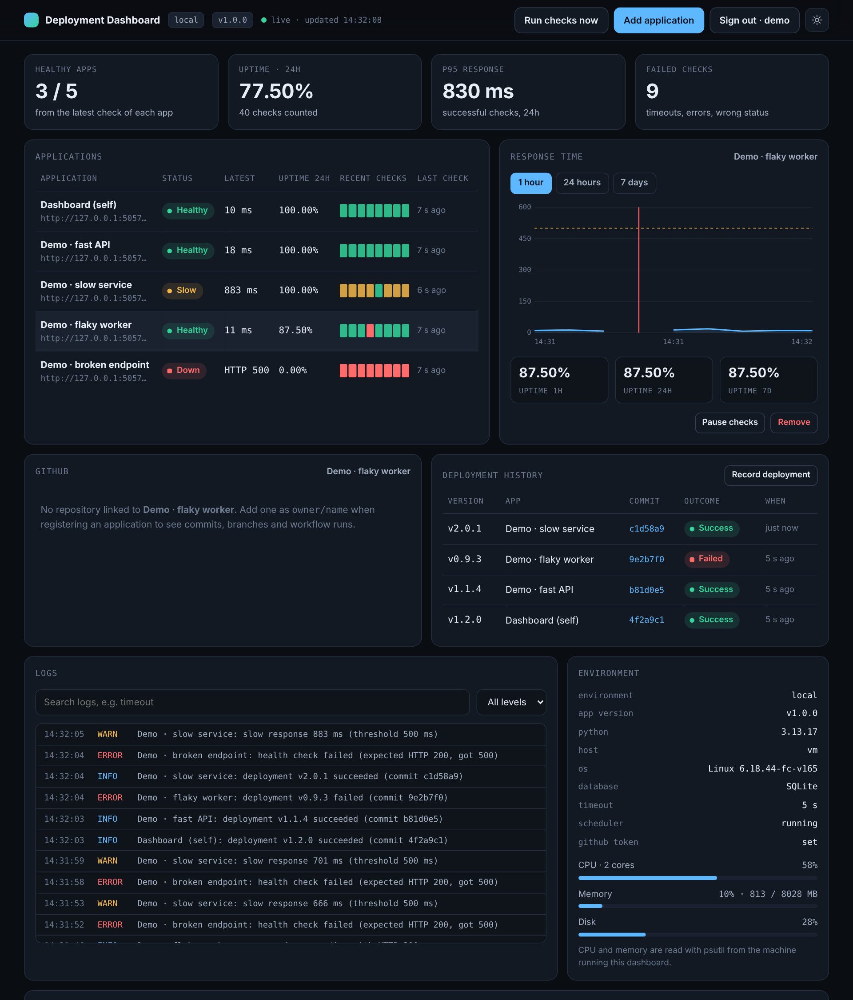
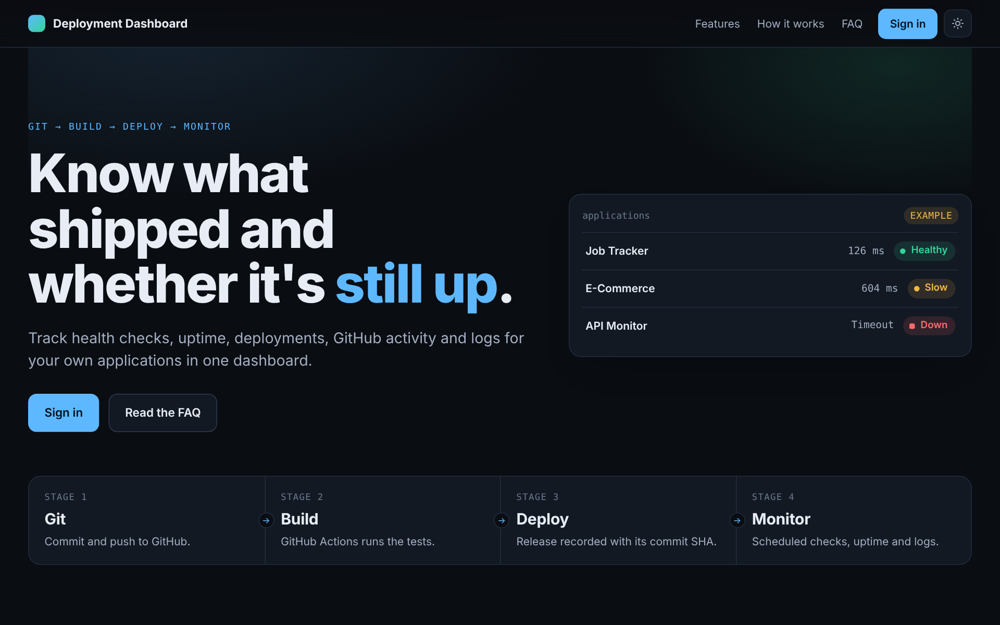
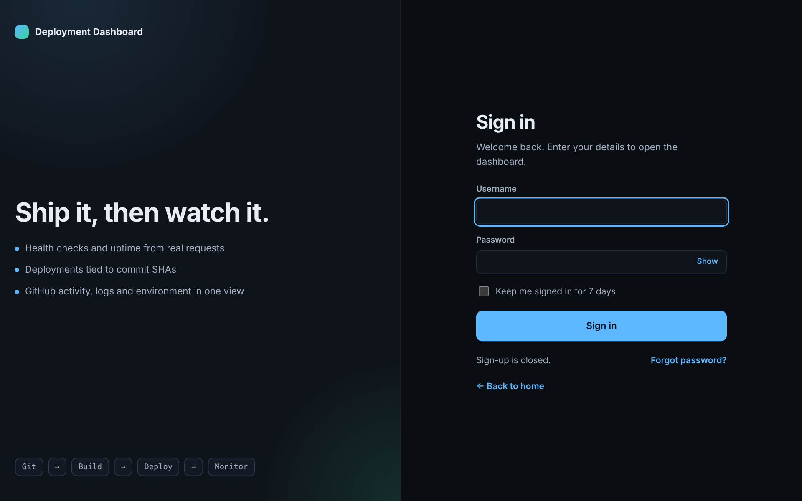
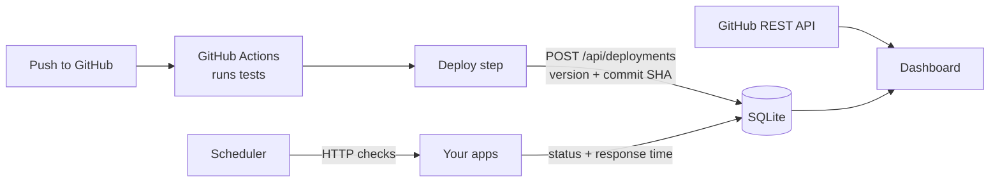

<div align="center">

# Deployment Dashboard

**Know what shipped, and whether it's still up.**

A small self-hosted platform that watches your own applications and shows the whole path
**Git → Build → Deploy → Monitor** in one place.


[](https://github.com/modya2005/mini-devops-dashboard/actions)



</div>

---

## What it does

| | |
|---|---|
| **Health checks** | Requests each URL on a schedule and stores the status code, response time and any error. Handles timeouts and unreachable hosts. |
| **Uptime** | Successful checks ÷ total checks × 100 over 1 hour, 24 hours and 7 days. Maintenance pauses are not counted. |
| **Deployment history** | Version, commit SHA, outcome and time for each release, recorded from CI with one command. |
| **GitHub activity** | Branches, latest commits and GitHub Actions runs for linked repositories. |
| **Logs** | Failures, slow responses, recoveries, deployments and changes, searchable and filterable by level. |
| **Environment** | Environment name, app and Python versions, plus CPU, memory and disk of the host (via `psutil`). |
| **Charts** | Response time per app over an hour, a day or a week, with failed checks marked. |
| **Private by default** | Sign-in required. Hashed passwords, CSRF protection, rate-limited login. |

Status is **always derived from real checks**, never typed in by hand.

## Screenshots

<table>
<tr>
<td width="50%"><br><sub>Home page with a searchable FAQ</sub></td>
<td width="50%"><br><sub>Sign-in page</sub></td>
</tr>
</table>

## Quick start

You need Python 3.12 or newer.

```bash
git clone https://github.com/YOUR_USERNAME/mini-devops-dashboard.git
cd mini-devops-dashboard

python -m venv .venv
source .venv/bin/activate          # Windows: .venv\Scripts\activate
pip install -r requirements.txt

python app.py
```

Open **http://localhost:5000**, press **Sign in**, and create your owner account.
That's it. The first time you run it, five demo targets are registered so you can watch real checks succeed,
run slowly and fail straight away.

> The demo targets are real HTTP requests to endpoints this app serves itself (`/demo/ok`, `/demo/slow`,
> `/demo/flaky`, `/demo/down`, `/health`). Delete them in the dashboard or set `SEED_DEMO=0` to start empty.

### With Docker

```bash
cp .env.example .env
docker compose up --build
```

Data is kept in a named volume. To create the owner account without using the browser, set
`ADMIN_USER` and `ADMIN_PASSWORD` in `.env`.

## Add your own app

1. Sign in and press **Add application**.
2. Enter a name and a health URL, for example `https://myapp.example.com/health`.
3. Optionally set the check interval, the expected status code, and a GitHub repo as `owner/name`.

The first check runs right away. Only monitor systems you own or have permission to check.

## How it works



- A background scheduler inside the Flask process requests each app on its own interval and writes every result to SQLite.
- Status (Healthy, Slow, Degraded, Down, Paused) and uptime are calculated from the stored checks whenever the page asks.
- The browser polls the JSON API every 5 seconds.

### Status rules

| Status | Meaning |
|---|---|
| **Healthy** | Last check returned the expected status within the timeout and under the slow threshold (500 ms by default). |
| **Slow** | Last check passed but took longer than the threshold. |
| **Degraded** | The last check failed once. |
| **Down** | The last two checks in a row failed. |
| **Paused** | Checks are switched off for maintenance and not counted in uptime. |

## Record deployments from CI

Set a secret on the dashboard and in your repository:

```bash
# .env on the dashboard
DEPLOY_TOKEN=a-long-random-string
```

Then add a step after your deploy in GitHub Actions:

```yaml
- name: Record deployment
  env:
    DEPLOY_TOKEN: ${{ secrets.DEPLOY_TOKEN }}
  run: >
    python scripts/record_deploy.py
    --url "${{ secrets.DASHBOARD_URL }}"
    --app "My App"
    --version "build-${{ github.run_number }}"
    --sha "${{ github.sha }}"
    --status success
```

A ready-to-uncomment version is in [`.github/workflows/tests.yml`](.github/workflows/tests.yml).
You can also use the **Record deployment** button in the dashboard.

## Configuration

Everything is an environment variable. Copy `.env.example` to `.env` to change them. Never commit `.env`.

| Variable | Default | What it does |
|---|---|---|
| `PORT` | `5000` | Port to listen on |
| `ENV_NAME` | `local` | Environment label shown in the dashboard |
| `APP_VERSION` | `1.0.0` | Version label shown in the dashboard |
| `DATABASE` | `instance/dashboard.db` | SQLite file location |
| `DEFAULT_INTERVAL` | `30` | Seconds between checks for new apps |
| `CHECK_TIMEOUT` | `5` | Seconds before a check counts as a timeout |
| `SLOW_MS` | `500` | Responses slower than this show as Slow |
| `RETENTION_DAYS` | `30` | Checks and logs older than this are deleted |
| `SEED_DEMO` | `1` | Register the built-in demo targets on first run |
| `GITHUB_TOKEN` | empty | Optional. Raises the GitHub API limit to 5,000/hour and allows private repos |
| `DEPLOY_TOKEN` | empty | Lets CI post deployments without a browser session |
| `SECRET_KEY` | generated | Signs session cookies. If empty, one is created in `instance/secret_key` |
| `ALLOW_SIGNUP` | `0` | Set `1` to let more people register. The first account can always be created |
| `ADMIN_USER` / `ADMIN_PASSWORD` | empty | Create the owner at startup if there are no users |
| `SECURE_COOKIES` | `0` | Set `1` when serving over HTTPS |
| `SCHEDULER` | `1` | Set `0` to turn off background checks |

## Security

- Passwords are stored as salted PBKDF2 hashes.
- Sessions use signed, `HttpOnly`, `SameSite=Lax` cookies.
- Forms use CSRF tokens, and state-changing API requests from other origins are rejected.
- Failed sign-ins are rate limited (8 per 10 minutes per address), and the `next` redirect only accepts same-site paths.
- The dashboard and every `/api/*` route require sign-in. `/`, `/login`, `/health` and `/demo/*` are public.
- Secrets live in environment variables, never in code.

Forgot your password? Run this on the server:

```bash
python scripts/reset_password.py your-username
```

## API

All routes need a signed-in session, except where noted.

| Method | Route | Purpose |
|---|---|---|
| `GET` | `/api/overview` | Summary numbers |
| `GET` `POST` | `/api/apps` | List or add applications |
| `PATCH` `DELETE` | `/api/apps/<id>` | Pause/resume or remove |
| `GET` | `/api/apps/<id>/checks?window=1h\|24h\|7d` | Check history |
| `GET` | `/api/apps/<id>/github` | Repo, branches, commits, workflow runs |
| `POST` | `/api/check` | Run all checks now |
| `GET` `POST` | `/api/deployments` | List or record deployments (POST also accepts `X-Deploy-Token`) |
| `GET` | `/api/logs?q=&level=` | Search logs |
| `GET` | `/api/environment` | Host and runtime details |
| `GET` | `/health` | Public liveness endpoint |

## Project structure

```
app.py                     Flask app, JSON API, scheduler
auth.py                    Users, sign-in, CSRF, rate limiting, API guard
config.py                  Settings from environment
db.py                      SQLite schema and helpers
faq.py                     FAQ content for the home page
monitor/
  health_checks.py         HTTP checks, status, uptime
  github_client.py         GitHub REST API client
  metrics.py               Host metrics (psutil)
templates/                 home, login, dashboard
static/                    CSS and JavaScript
scripts/
  record_deploy.py         Post a deployment from CI
  reset_password.py        Reset or create a user
tests/                     Automated tests
.github/workflows/         CI
Dockerfile, docker-compose.yml
```

## Tests

```bash
python -m unittest discover -s tests -t . -v      # pytest works too
```

The suite covers health checks (success, wrong status, timeout, unreachable), status and uptime calculation,
sign-in and sign-up rules, CSRF and rate limiting, protected API routes, deployments tied to commit SHAs,
log search, maintenance pauses, the GitHub client (mocked) and the FAQ markup.
GitHub Actions runs it on every push and pull request.

## Limitations

- The scheduler runs inside the web process, so run **one worker** (the Dockerfile does).
- CPU and memory describe the machine running the dashboard, not the apps it checks.
- SQLite suits a single small instance.
- Chart.js loads from a CDN. Offline, the chart falls back to a simpler built-in version.
- No email, so password resets happen on the server with `scripts/reset_password.py`.

## Roadmap

- Alerts by email or webhook when an app goes down
- Per-app maintenance schedules
- Multiple users with roles
- PostgreSQL option

## Learn more

[Flask](https://flask.palletsprojects.com/en/stable/tutorial/) ·
[GitHub Actions](https://docs.github.com/en/actions) ·
[GitHub REST API](https://docs.github.com/en/rest) ·
[Chart.js](https://www.chartjs.org/docs/latest/) ·
[psutil](https://psutil.readthedocs.io/) ·
[Docker](https://docs.docker.com/get-started/)
